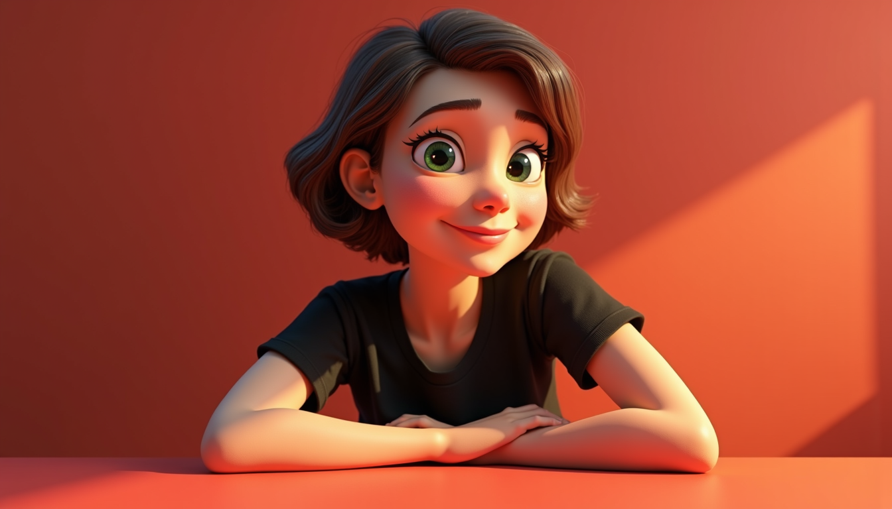

# Personagens e Contact Sheets

Pixel style: nome usado pelo Matheus para o estilo da imagem abaixo. Usar esta referência por padrão quando ele pedir pixel style sem fornecer outra. Não copiar automaticamente pose, rosto, roupa ou cenário.



Imagem-base → prancha de corpo → prancha de rosto → cena/selfie → ajustes. Cada personagem tem sua própria imagem-base e prancha.

Fontes: [Criar referência pixel 3D](https://chatgpt.com/share/6aded855-40a4-83e9-b3df-2734da7a14f8) · [Recriar personagens brasileiras](https://chatgpt.com/share/6aded865-ed2c-83e9-b26a-cfc22047f15c). A criação do zero é uma extensão dos fluxos observados. Modelos não testados em novas gerações.

## PERS-01 · Criar personagem do zero — pixel style

Criar uma imagem-base original antes das pranchas. Referência pixel style: http://127.0.0.1:4317/referencias/pixel-style-padrao.png

```text
Crie uma imagem-base de uma personagem original.

Referência de estilo: anexe pixel-style-padrao.png. “Pixel style” é o nome usado por Matheus para o acabamento 3D desta imagem: volumes arredondados, olhos expressivos, cabelo volumétrico e superfícies suaves. Não interpretar como pixel art ou voxel. A imagem define o acabamento; rosto, roupa, pose, cenário e cores seguem o briefing. Só copie a pose se solicitado. Uma referência de estilo explicitamente fornecida para o pedido tem prioridade sobre esse padrão.

PERSONAGEM
Nome: [nome]. Idade aparente: [idade]. Pele: [tom]. Rosto e olhos: [descrição]. Cabelo: [cor, textura e penteado]. Corpo: [proporções]. Personalidade visual: [descrição]. Profissão: [profissão]. Roupa e acessórios: [descrição].

CENA
Ambiente: [local]. Pose e ação: [descrição]. Enquadramento: [descrição]. Proporção: [proporção].

Gere uma única personagem em uma única imagem de apresentação. Não faça colagem ou contact sheet. A identidade será escolhida antes das próximas etapas.
```

## PERS-02 · Recriar a mesma personagem em outro estilo

Converter o acabamento preservando a identidade. Referência pixel style: http://127.0.0.1:4317/referencias/pixel-style-padrao.png

```text
Recrie a personagem da imagem 1 no acabamento visual da imagem 2.

Imagem 1 = identidade. Imagem 2 = estilo. Na ausência de outro estilo fornecido, use a referência pixel-style-padrao.png anexada.

Referência de estilo: anexe pixel-style-padrao.png. “Pixel style” é o nome usado por Matheus para o acabamento 3D desta imagem: volumes arredondados, olhos expressivos, cabelo volumétrico e superfícies suaves. Não interpretar como pixel art ou voxel. A imagem define o acabamento; rosto, roupa, pose, cenário e cores seguem o briefing. Só copie a pose se solicitado. Uma referência de estilo explicitamente fornecida para o pedido tem prioridade sobre esse padrão.

Preserve a identidade da imagem-base escolhida: rosto, idade aparente, tom de pele, olhos, nariz, boca, sobrancelhas, cabelo e proporções. Não misture identidades nem substitua o rosto por um rosto genérico. Preserve o estilo e o figurino, salvo alteração explicitamente solicitada.

Traduza os traços para o novo estilo sem copiar o rosto da imagem 2.
Alterações autorizadas: [lista]. Ambiente: [local]. Pose: [descrição]. Enquadramento: [descrição]. Proporção: [proporção].
Gere uma única imagem-base para avaliação, sem prancha.
```

## PERS-03 · Criar nova personagem a partir de referência

Reutilizar a linguagem visual com uma nova identidade. Referência pixel style: http://127.0.0.1:4317/referencias/pixel-style-padrao.png

```text
Crie uma nova personagem usando a imagem anexada como referência de linguagem visual.

Referência de estilo: anexe pixel-style-padrao.png. “Pixel style” é o nome usado por Matheus para o acabamento 3D desta imagem: volumes arredondados, olhos expressivos, cabelo volumétrico e superfícies suaves. Não interpretar como pixel art ou voxel. A imagem define o acabamento; rosto, roupa, pose, cenário e cores seguem o briefing. Só copie a pose se solicitado. Uma referência de estilo explicitamente fornecida para o pedido tem prioridade sobre esse padrão.

Mantenha o grau de estilização, linguagem de formas, tratamento dos olhos, materiais e acabamento. Crie a identidade abaixo.
Nome: [nome]. Idade: [idade]. Pele: [tom]. Rosto e olhos: [descrição]. Cabelo: [descrição]. Corpo: [descrição]. Roupa: [descrição]. Personalidade: [descrição].
Ambiente: [local]. Pose: [descrição]. Proporção: [proporção].
Não deduza características físicas somente da nacionalidade; use os atributos descritos. Gere uma personagem por imagem, sem contact sheet. Se houver várias personagens, desenvolva cada imagem-base separadamente.
```

## PERS-04 · Contact sheet de corpo — quatro vistas

Registrar a personagem escolhida de frente, lados e costas. Referência pixel style: http://127.0.0.1:4317/referencias/pixel-style-padrao.png

```text
Crie uma character turnaround sheet da personagem anexada. A imagem-base escolhida define a identidade e o acabamento.

Preserve a identidade da imagem-base escolhida: rosto, idade aparente, tom de pele, olhos, nariz, boca, sobrancelhas, cabelo e proporções. Não misture identidades nem substitua o rosto por um rosto genérico. Preserve o estilo e o figurino, salvo alteração explicitamente solicitada.

Uma prancha horizontal 16:9, fundo cinza-claro uniforme, com quatro vistas: frente, perfil esquerdo, costas e perfil direito. Corpo inteiro em todas, incluindo cabelo, mãos e pés. Mesma escala, linha de chão e iluminação suave. Pose neutra, braços ligeiramente afastados do tronco. Espaço entre as vistas.

Complete detalhes ocultos de forma simples e coerente. Uma única personagem por prancha. Não misture duas personagens, não varie figurino nem adicione cenário, expressões extras, títulos ou textos.
```

## PERS-05 · Contact sheet de rosto e expressões

Registrar ângulos e expressões sem perder o rosto. Referência pixel style: http://127.0.0.1:4317/referencias/pixel-style-padrao.png

```text
Crie uma prancha de referência facial da personagem anexada.

Preserve a identidade da imagem-base escolhida: rosto, idade aparente, tom de pele, olhos, nariz, boca, sobrancelhas, cabelo e proporções. Não misture identidades nem substitua o rosto por um rosto genérico. Preserve o estilo e o figurino, salvo alteração explicitamente solicitada.

Prancha horizontal 16:9, duas linhas com quatro quadros cada. Linha superior: frente neutra, três quartos à esquerda, perfil e três quartos à direita. Linha inferior, vista frontal: sorriso natural, alegria com sorriso aberto, surpresa e concentração. Cabeça e parte dos ombros, escala semelhante, fundo cinza-claro uniforme, luz suave.

Modifique somente a expressão nos quadros correspondentes; não mude idade, cabelo, roupa ou acessórios. Uma personagem por prancha. Sem texto.
Se o pedido for detalhes faciais em vez de expressões, substitua apenas a linha inferior por quatro ampliações: olhos e sobrancelhas; nariz; boca; cabelo e linha do cabelo.
```

## PERS-06 · Cena ou selfie com uma ou duas personagens

Usar identidades escolhidas em uma nova cena. Referência pixel style: http://127.0.0.1:4317/referencias/pixel-style-padrao.png

```text
Crie uma única cena com as personagens anexadas.
Imagem 1 = [personagem A]. Imagem 2 = [personagem B, se houver]. Outras imagens = [papel de cada referência].

Preserve a identidade da imagem-base escolhida: rosto, idade aparente, tom de pele, olhos, nariz, boca, sobrancelhas, cabelo e proporções. Não misture identidades nem substitua o rosto por um rosto genérico. Preserve o estilo e o figurino, salvo alteração explicitamente solicitada.

Local: [local]. Ação: [ação]. Expressões: [descrição]. Roupa: [manter ou mudança autorizada]. Objetos: [objetos]. Composição: [uma personagem / duas juntas na mesma imagem]. Proporção: [proporção]. Uso final: [uso].

Se for selfie: perspectiva da câmera frontal de celular segurado por [personagem], braço e olhar coerentes, celular fora do campo. Com duas personagens, mantenha ambos os rostos inteiros, distintos e próximos.

Para perfil: 1:1 com rostos dentro da região central do futuro recorte circular e margem ao redor. Para Stories: 9:16 vertical. Para horizontal: 16:9. Escolha a opção do briefing; não misture formatos. Sem colagem, divisão em quadros ou texto.
```

## PERS-07 · Expandir imagem sem aumentar rostos

Acrescentar cenário mantendo escala, pose e perspectiva. Referência pixel style: http://127.0.0.1:4317/referencias/pixel-style-padrao.png

```text
Expanda a imagem anexada para [16:9 horizontal / 9:16 vertical / proporção desejada].

Acrescente área [nas laterais / acima e abaixo / em todas as direções], continuando o cenário com a mesma perspectiva, luz, materiais e acabamento.

Preserve rostos, expressões, poses, roupas, objetos e ângulo da imagem original. Não aumente as personagens nem aproxime a câmera. Não recorte o conteúdo existente.

Se necessário, reduza o conjunto original proporcionalmente para acomodá-lo ao novo quadro, sem deformar ou reposicionar personagens individualmente. O resultado deve mostrar mais espaço ao redor. Uma única imagem expandida, sem molduras, faixas vazias ou elementos repetidos.
```

## PERS-08 · Editar somente um detalhe da imagem

Corrigir um elemento preservando a composição. Referência pixel style: http://127.0.0.1:4317/referencias/pixel-style-padrao.png

```text
Edite a imagem anexada fazendo somente a alteração abaixo.

Alteração: [o que muda]. Área ou personagem: [onde muda].

Preserve todo o restante: identidade, idade, pele, olhos, cabelo, expressão, pose, roupa, cenário, enquadramento, iluminação e acabamento, exceto o que estiver explicitamente incluído na alteração.

Não redesenhe nem acrescente elementos por iniciativa própria. Entregue a imagem completa com a correção aplicada.
```

🏠 [[05_Biblioteca/03_recursos/Prompts-Geracao/Prompts-Geracao|Prompts de Geração]]
